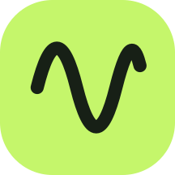
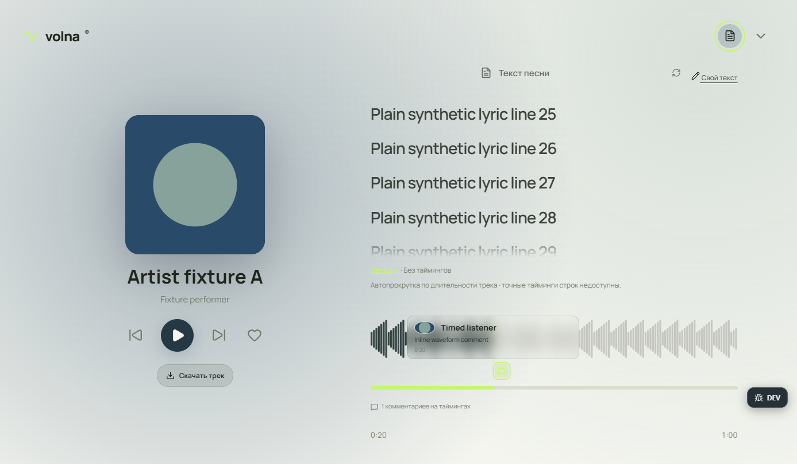

# VOLNA

### Музыка в твоём ритме. Интерфейс в твоём стиле.

**Плеер для Windows с SoundCloud, персональной волной и гибким оформлением.**

[**Скачать VOLNA**](https://github.com/ijusttryit/VOLNA/releases/latest) · [Что нового](CHANGELOG.md) · [Сообщить о баге](https://github.com/ijusttryit/VOLNA/issues)

---

VOLNA объединяет музыку, рекомендации и персональное оформление в одном приложении. Можно сразу войти гостем, найти публичный трек SoundCloud, собрать свою очередь и настроить внешний вид под себя.

*Данные на скриншоте демонстрационные.*

## Что умеет VOLNA

| Возможность | Как это работает |
|---|---|
| **SoundCloud** | Поиск и воспроизведение доступных полных публичных потоков в плеере VOLNA. |
| **Моя волна** | Настроение, жанры, свежая музыка, запрещённые хештеги и переключатель повторов. |
| **Живая очередь** | Добавление, перестановка, перемешивание и история прослушанной волны. Дизлайк исключает трек и переключает музыку. |
| **Быстрые переходы** | Следующий поток готовится заранее; кэш помогает при повторном воспроизведении. |
| **Карточка трека** | Метаданные, waveform, комментарии SoundCloud по таймингам и личные заметки. |
| **Тексты песен** | Поиск в LRCLIB, подсветка строк LRC и возможность сохранить свой текст. |
| **Оформление** | Градиентные темы, собственный CSS, изображения/GIF и шрифты. Конструктор меняет отдельные блоки, кнопки и каталоги. |
| **Трей Windows** | Крестик скрывает окно, музыка продолжает играть. В меню трея — пауза, следующий трек и выход. |
| **DEV** | Журнал ошибок, состояние плеера, проверки и экспорт отчёта для разбора багов. |

## Установка

1. Открой [последний выпуск](https://github.com/ijusttryit/VOLNA/releases/latest).
2. Скачай файл **VOLNA-Setup-…exe** и запусти установщик.
3. Открой VOLNA и выбери **«Продолжить как гость»**.
4. Найди музыку по названию или вставь ссылку на отдельный трек SoundCloud.

Сборки предназначены для **Windows x64**. Интернет нужен для поиска и получения новых потоков. Для уменьшения задержек оставь включённым **Настройки → Плеер → Кэш музыки**.

## Сделай приложение своим

В **Настройки → Элементы** выбери нужный блок и настрой его цвет, рамку, скругление, отступы, шрифт и персональное изображение/GIF. Изменения сохраняются в профиле устройства; сброс одного элемента не меняет остальные.

Для более сложного оформления открой редактор CSS в Мастерской. Там есть справочник классов и ID. Гость может использовать локальные стили и вложения. Публикация в общей мастерской, голосование, общие плейлисты и серверный аккаунт зависят от подключения доступного сервера VOLNA.

## Нашёл баг?

Нажми **DEV** в правом углу, включи подробные логи и повтори проблему. Добавь короткое описание действий и сохрани JSON-отчёт.

В [обращении](https://github.com/ijusttryit/VOLNA/issues) укажи версию приложения, что ожидалось и что произошло. Перед публичной загрузкой проверь отчёт: он может содержать названия треков и написанное тобой описание. Приложение не собирает в отчёт пароли, токены, адреса потоков и тела запросов. Ничего автоматически не отправляется.

## Доступность музыки

Доступ к потоку определяет SoundCloud. Региональные ограничения, удалённые треки, preview и закрытый каталог Go+ могут мешать воспроизведению. Наличие подписки Go+ само по себе не подключает её к VOLNA. Нулевая задержка при любых условиях не гарантируется.

Скачивание зависит от доступности трека и источника; выбирай место сохранения в системном диалоге. Подключения Spotify Connect и Яндекс Музыки зависят от настройки интеграции, аккаунта и требований соответствующего сервиса.

## Исходники

Этот репозиторий содержит **документацию, изображения интерфейса и готовые установщики в Releases**. Исходный код приложения, внутренняя история разработки, пользовательские данные и диагностические журналы здесь не публикуются.

VOLNA развивается как приложение с закрытым исходным кодом. Сторонние компоненты распространяются на условиях своих лицензий; уведомления о них включены в дистрибутив.

---

SoundCloud, Spotify и Яндекс Музыка — независимые сервисы. VOLNA не является их официальным приложением.
